# LearnAble AI: Adaptive Learning for Inclusive Education

**NeuralStorm 2026 · Human Impact · HI-03: Adaptive Learning for Students with Disabilities**

> **Prototype status:** This is a working Python/Streamlit prototype using a documented synthetic dataset. It demonstrates an adaptive-learning workflow; it is not a clinically validated or proven educational intervention.

LearnAble AI adapts *how* a lesson is delivered (text, audio, diagrams or step-by-step), plus the pace, support level and quiz difficulty, to each student's own preferences and performance. Students choose their own preferences and accessibility settings. The system **suggests learning adaptations; it never diagnoses or labels a student.**

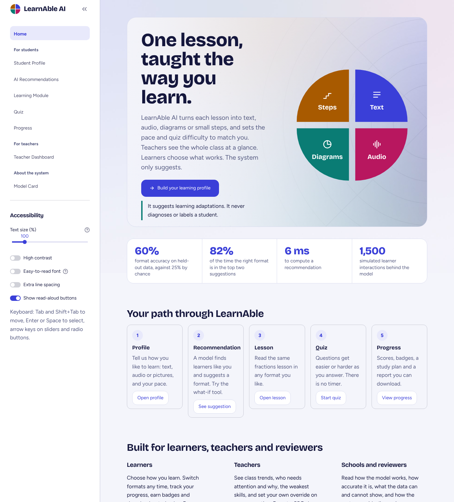

## The problem

One teaching method does not fit every learner. Some students do better with audio than dense text, some need diagrams, some need a topic split into small steps, and some need more time and practice. Students with disabilities are often the least served by one-size-fits-all content, and they should be the ones deciding what works for them.

## What it does

| # | Feature | Where |
|---|---------|-------|
| 1 | **Student learning profile**: text/audio/visual preference, reading speed, pace, explanation detail | Student Profile |
| 2 | **ML recommendation** of the best learning format, with reasons and the similar learners used | AI Recommendations |
| 3 | **Adaptive content**: the same lesson in 4 formats (+ original wording), chosen by the model but always overridable | Learning Module |
| 4 | **Adaptive quiz**: difficulty rises or falls with recent answers; explanations after every answer; no time limit | Quiz |
| 5 | **Progress tracking**: score trend, accuracy per skill, "needs attention" topics, next steps | Progress |
| 6 | **Teacher dashboard** (simulated class of 96): filters, KPIs with trends, who needs attention and why, skill heatmap, format mix, student detail with **teacher override**, CSV and PDF class report | Teacher Dashboard |
| 7 | **What-if explorer**: move the sliders and watch the suggestion change live | AI Recommendations |
| 8 | **Achievements**: XP, levels and badges; interactive **study plan**; downloadable **PDF progress report** | Progress |
| 9 | **Model card**: accuracy, per-format metrics, confusion matrix, responsible-AI notes and roadmap | Model Card |
| 10 | **Accessibility settings** on every page: text size 80–200%, high contrast, easy-to-read font, extra spacing, read-aloud (text-to-speech), captions/transcripts, visible keyboard focus | Sidebar |

| Recommendation | Lesson (visual format) | High contrast |
|---|---|---|
| 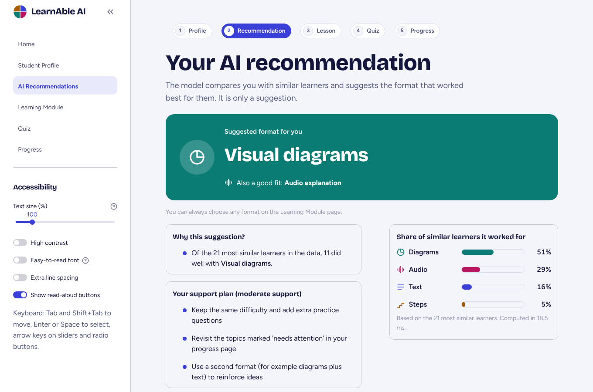 | 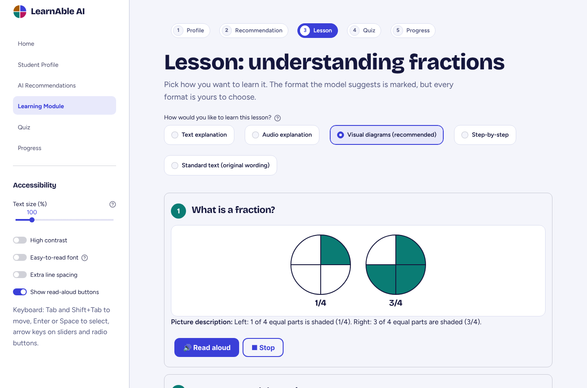 |  |

| Quiz | Quiz feedback | Progress |
|---|---|---|
| 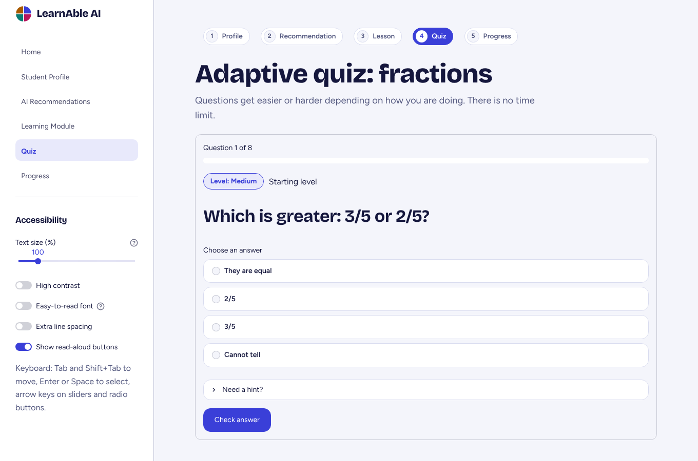 | 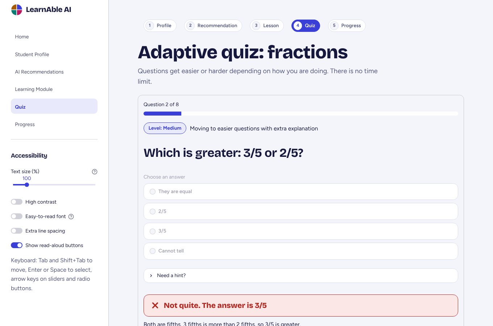 | 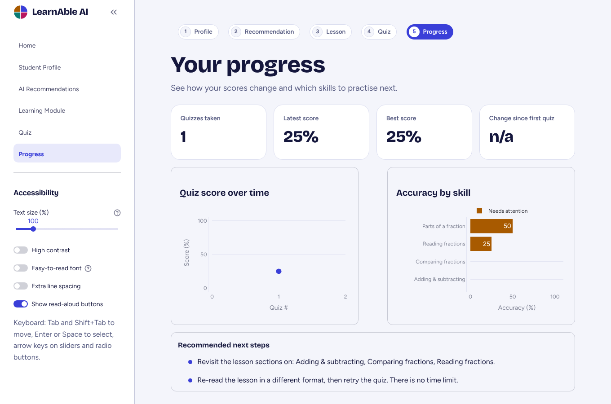 |

| Teacher dashboard | Skill heatmap | Student detail and override |
|---|---|---|
| 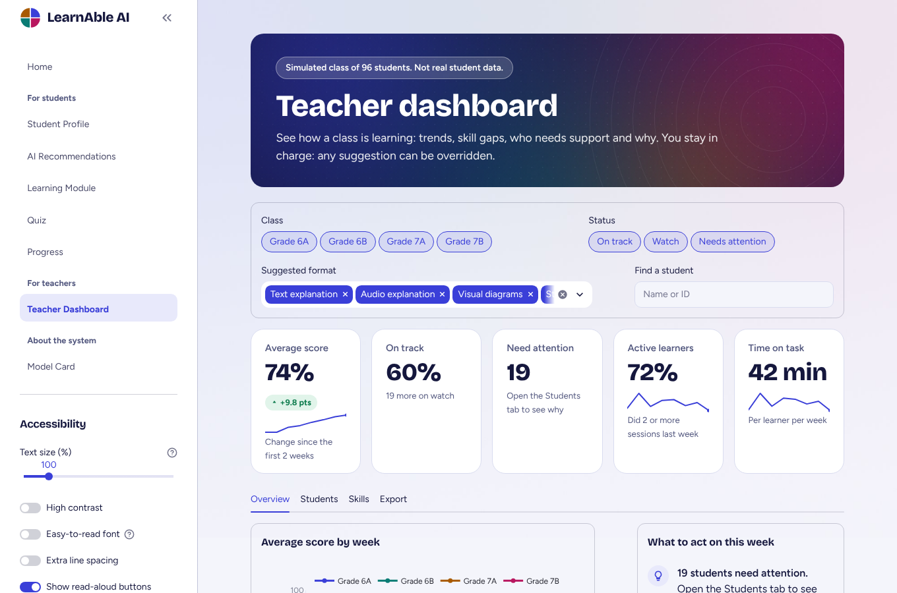 | 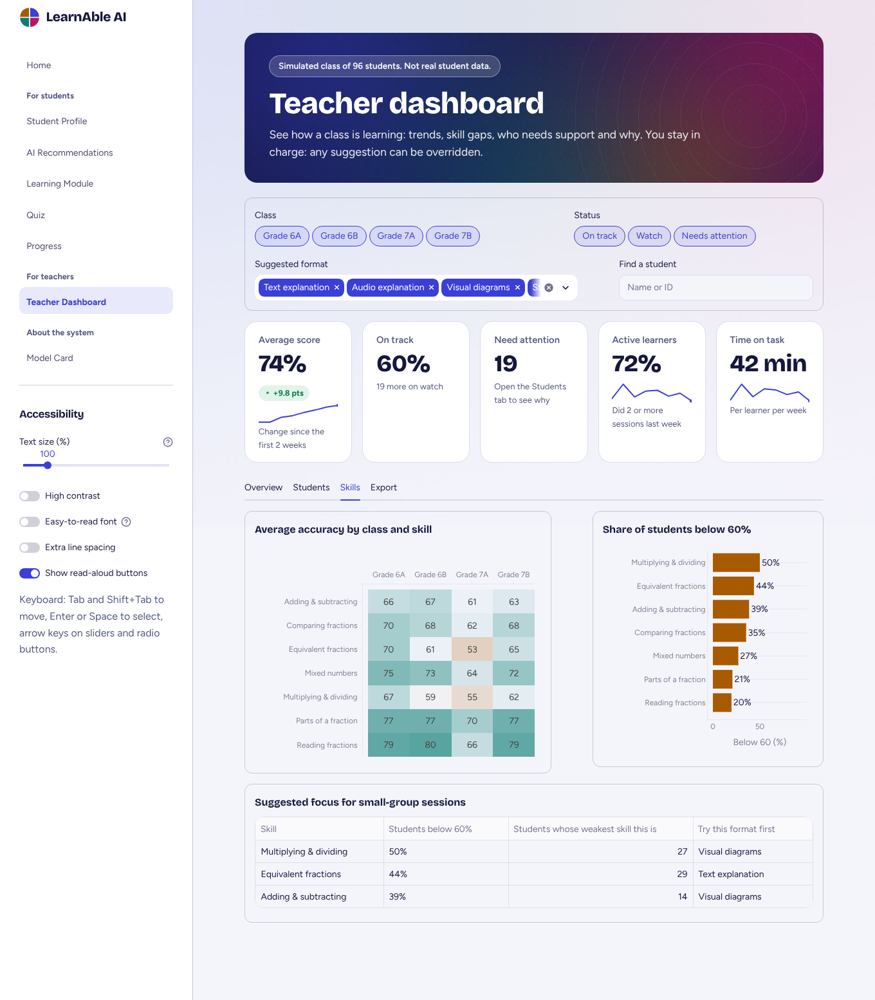 | 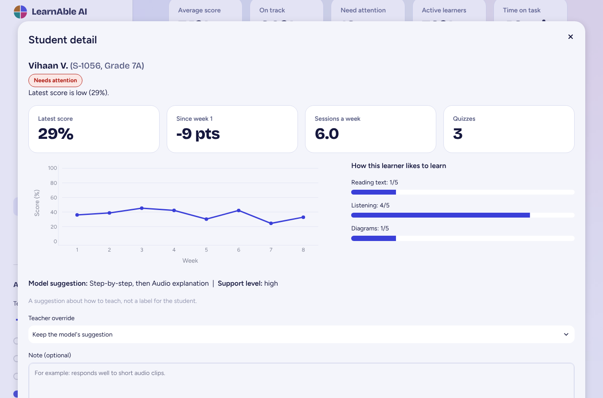 |

| Achievements | What-if explorer | Model card |
|---|---|---|
| 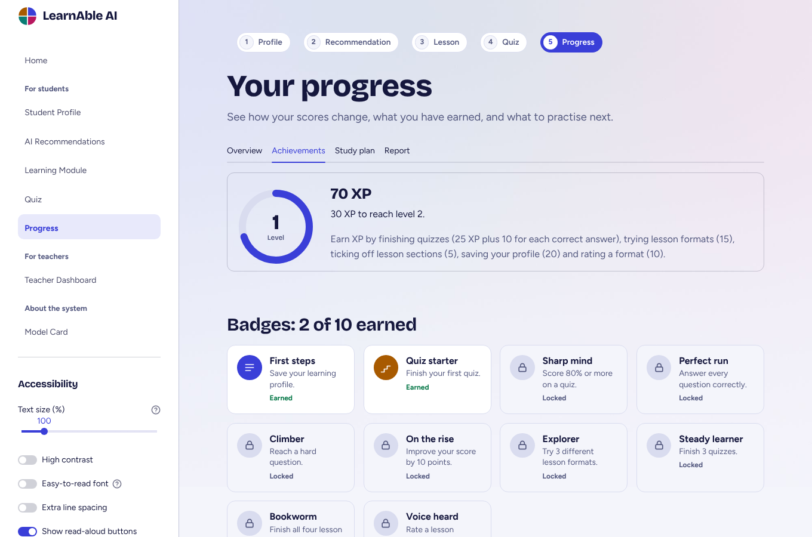 | 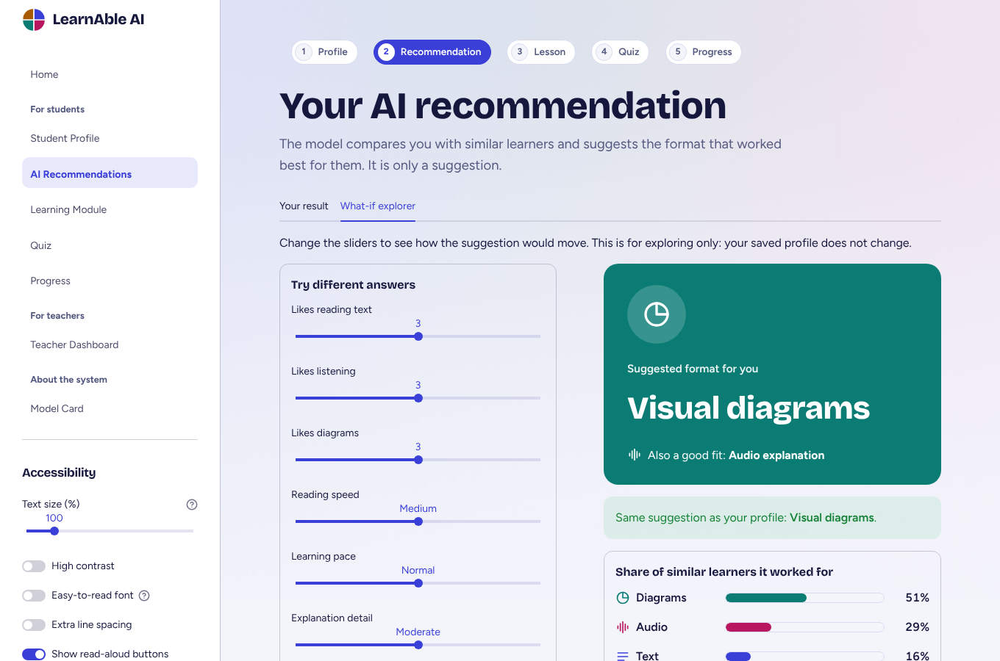 | 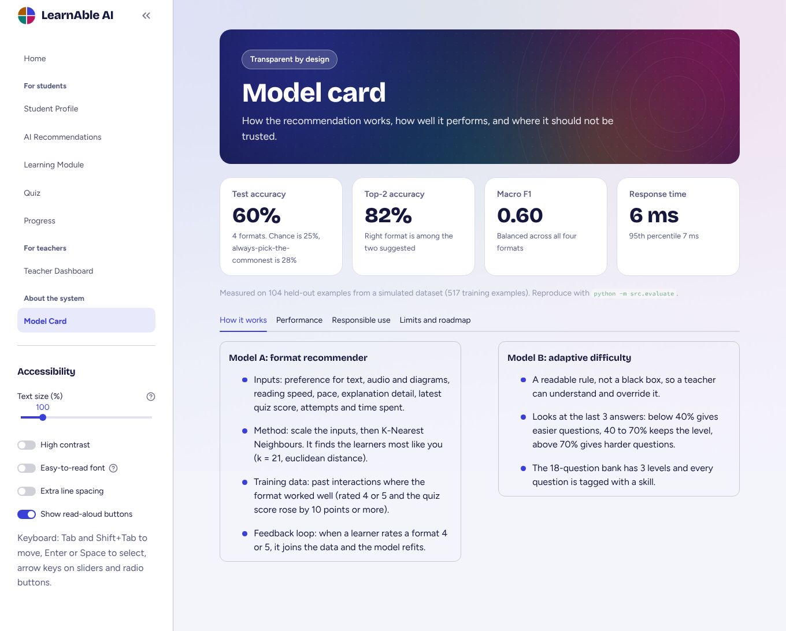 |

## How the AI works

### Model A: personalised format recommender (K-Nearest Neighbours)
- **Inputs (9 features):** preference for text / audio / visual (1–5), reading speed, pace, explanation detail, latest quiz score, number of attempts, time spent.
- **Training data:** past learner interactions where the format **worked well** (rating ≥ 4 and quiz score gain ≥ 10). The label is the format that worked.
- **Model:** `StandardScaler` → `KNeighborsClassifier(weights="distance")`. `k` (5, 9, 15, 21) and the distance metric (euclidean, cosine) are chosen by 5-fold cross-validated grid search. Best found: k = 21, euclidean.
- **Explainable:** the page shows the share of similar learners that did well with each format, the closest learners themselves, and plain-language reasons.
- **Feedback loop:** after a lesson the student rates the format. Ratings of 4–5 are added to the training data and the model is refit immediately, so the next recommendation can change.
- **Support plan (transparent rules):** score < 40% or ≥ 4 attempts → high support (small sections, worked examples, easier start); otherwise moderate or light support.

### Model B: adaptive difficulty (transparent rule)
Looks at the last (up to) 3 answers: accuracy **< 40%** → easier questions; **40–70%** → same level, more practice; **> 70%** → harder questions. The 18-question bank has 3 levels and every question is tagged with a skill, which feeds the progress dashboard. This is intentionally a readable rule, not a black box, so that a teacher can understand and override it.

## Evaluation (on simulated data)

Run `python -m src.evaluate` to reproduce. Results are saved to `models/evaluation_results.json`.

| Metric | Result |
|---|---|
| Training examples ("worked well" interactions) | 517 (from 1,500 simulated) |
| Held-out test accuracy (4 classes) | **59.6%** |
| Test macro F1 | 0.599 |
| Top-2 accuracy (true format in the 2 recommended) | 81.7% |
| Majority-class baseline / random baseline | 27.9% / 25% |
| 5-fold CV accuracy on training split | 54.2% |
| Agreement with 5 documented expected recommendations | 4 / 5 |
| Recommendation response time | mean 6.0 ms, p95 7.4 ms |

The one disagreement: the "fast visual learner" persona (strong visual preference, but fast reader with high score) was recommended *Text explanation* instead of *Visual diagrams*. The two are close in the data. It is a good example of why the interface shows the top-2 options and lets the student choose.

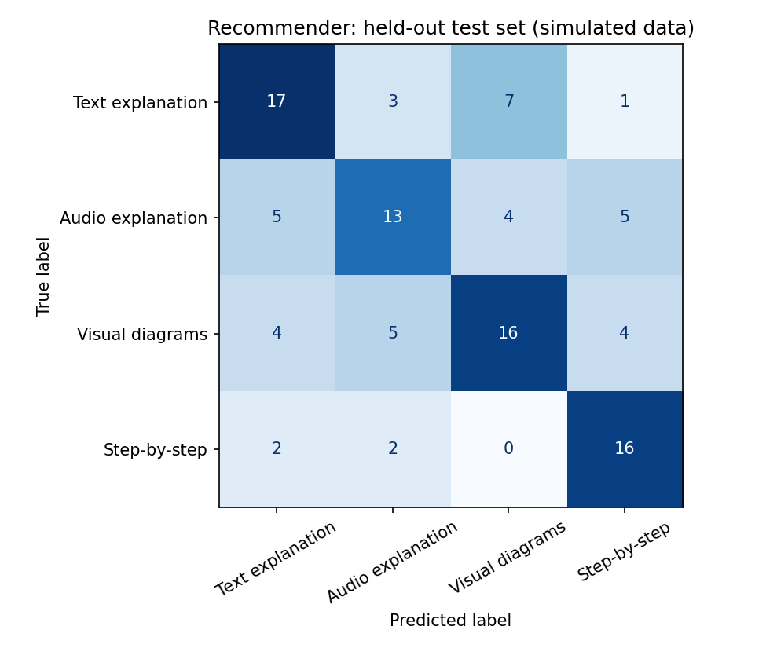

**Automated checks:** Run `python tests/test_app.py` after installing the requirements. The test suite is designed to render every page, complete an 8-question quiz, and generate the teacher PDF report. Run it in the same environment used for the final demo and record the result; do not claim a passing test run unless you have executed it.

## Design

The four learning formats each have one colour and one icon (text, audio, diagrams, steps), so meaning never depends on colour alone. The logo and home graphic are a circle cut into four parts: a fraction, like the lesson. Headings use Bricolage Grotesque, body text Figtree, and the optional easy-to-read font is Atkinson Hyperlegible. Fonts are self-hosted, so the app works offline. All colours are CSS variables in `src/theme.py`, which is how the high-contrast mode swaps the whole palette.

## Honest limitations

- **The teacher dashboard cohort is simulated** (96 made-up students, seeded and reproducible). The background images are generated artwork, not photographs.
- **The dataset is simulated.** The 1,500 interactions in `data/student_data.csv` are generated by documented rules plus noise (see `src/data_processing.py`). Accuracy figures show that the model learns the patterns in that data. They are **not** evidence that this improves learning for real students, and they are partly circular because the patterns were designed by us.
- **No real user study** has been done. Real use needs consented data and testing with students, teachers and accessibility specialists.
- **Not a diagnostic or clinical tool.** It does not detect or label disabilities. Students self-select preferences.
- **One topic only** (Fractions) and pre-written lesson variants.
- **Feedback data** is stored as anonymous feature rows in `data/feedback.csv` (no names). On Streamlit Community Cloud this file is not permanent and is shared by all users of the demo.
- **Read-aloud** uses the browser's built-in speech engine; voices vary by browser and device.
- Accessibility features were built to common good practice (large text, contrast, captions, keyboard focus, alt text on diagrams) but have **not** been audited against WCAG or tested with screen-reader users.

## Run it locally

```bash
git clone https://github.com/Jagruthi-31/TeamElevate
cd TeamElevate
python -m venv venv
source venv/bin/activate          # Windows: venv\Scripts\activate
pip install -r requirements.txt
streamlit run Home.py
```

Optional, to regenerate the data, retrain and re-evaluate:

```bash
python -m src.data_processing     # regenerate simulated dataset
python -m src.evaluate            # metrics + confusion matrix
```

The repository intentionally omits a version-sensitive serialized model. On first launch, the app trains the recommender from the included CSV and caches it for the session. This avoids loading a pickle created by a different scikit-learn/pandas environment.


## Project structure

```
TeamElevate/
├── Home.py                    # landing page
├── pages/                     # 1_Student_Profile, 2_AI_Recommendations,
│                              # 3_Learning_Module, 4_Quiz, 5_Progress,
│                              # 6_Teacher_Dashboard, 7_Model_Card
├── src/
│   ├── config.py              # features, formats, constants
│   ├── data_processing.py     # simulated dataset + preprocessing
│   ├── recommendation.py      # KNN recommender, explanations, feedback loop
│   ├── adaptive_quiz.py       # question bank + adaptive difficulty rule
│   ├── progress_tracking.py   # scores, skill accuracy, next steps
│   ├── content.py             # lesson variants + SVG diagrams
│   ├── theme.py               # design tokens, global CSS, HTML components
│   ├── cohort.py              # SIMULATED class of 96 students for the teacher dashboard
│   ├── gamification.py        # XP, levels, badges, study plan
│   ├── reports.py             # PDF progress report and class report
│   ├── accessibility.py       # text size, contrast, read-aloud
│   ├── app_helpers.py         # model loading, session state
│   └── evaluate.py            # evaluation script
├── data/student_data.csv      # SIMULATED dataset
├── models/                    # evaluation_results.json
├── tests/test_app.py          # smoke tests
├── tools/make_backgrounds.py  # generates the background artwork (optional)
├── static/img/                # generated background images
├── static/fonts/              # self-hosted Bricolage Grotesque, Figtree, Atkinson Hyperlegible
├── .streamlit/config.toml     # theme colours, static serving
└── assets/                    # logo, favicon, screenshots, confusion matrix
```

## Future work

Real data from a pilot with consent; more subjects; teacher dashboard and overrides; LLM-generated explanations with safety checks; screen-reader and WCAG audit; offline/low-bandwidth mode.

## Team


| Member | Contribution |
|---|---|
| Devineni Jagruthi | Add actual contribution |
| Samiksha G | Add actual contribution |
| Gajam Mania Kiran | Add actual contribution |

## AI-tool disclosure

If AI assistants or generative tools were used during development, disclose them according to the event rules. Suggested wording (edit to match what the team actually used):

> AI assistance was used for selected brainstorming, debugging, code review and documentation tasks. The team reviewed, tested and takes responsibility for the submitted code and project claims.

Do not claim that AI tools were not used if they were used. Add the names of the tools actually used and describe their contribution if the organizer requires that level of detail.

## Final submission checklist

- [ ] Public GitHub repository URL is correct and accessible without sign-in.
- [ ] README team names and contributions are complete.
- [ ] AI-tool disclosure is accurate and complete.
- [ ] Public demo URL works, or a demo video is included if permitted/required.
- [ ] `pip install -r requirements.txt` completes in a clean environment.
- [ ] `streamlit run Home.py` launches successfully.
- [ ] All seven pages and the full student journey are demonstrated.
- [ ] `python tests/test_app.py` passes in the final environment.
- [ ] Screenshots and evaluation claims match the submitted version.
- [ ] Submission is uploaded before the official deadline.

## Tech

Python · Pandas · NumPy · scikit-learn · Plotly · Streamlit · Joblib
